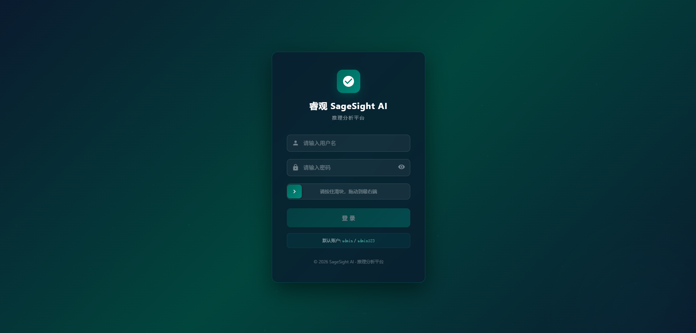
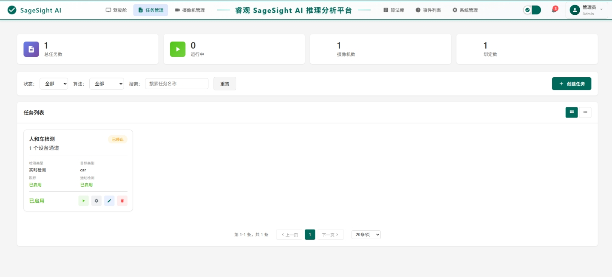
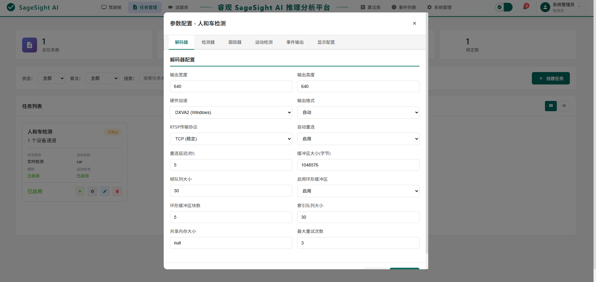
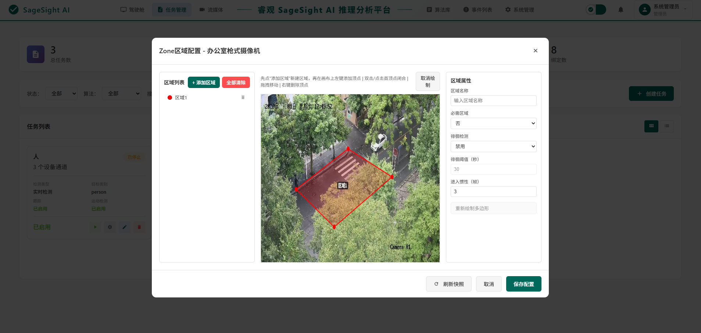
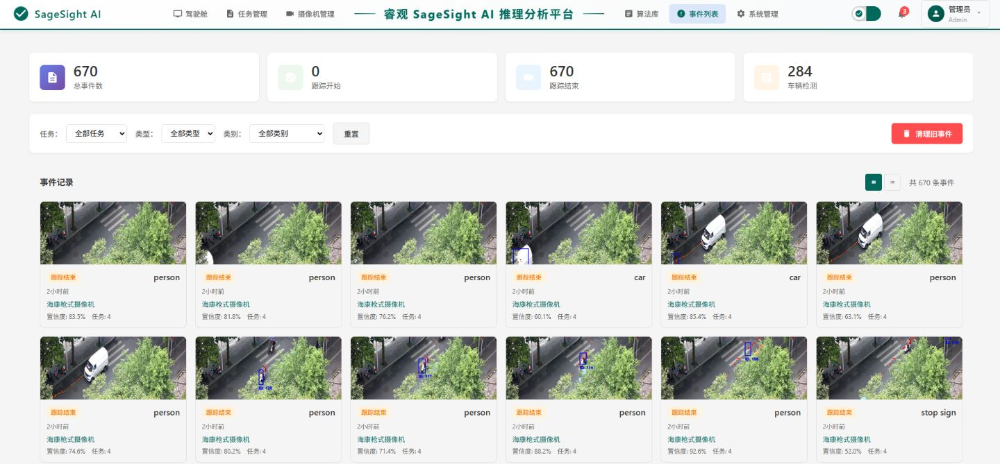
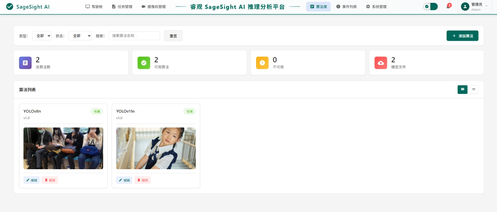
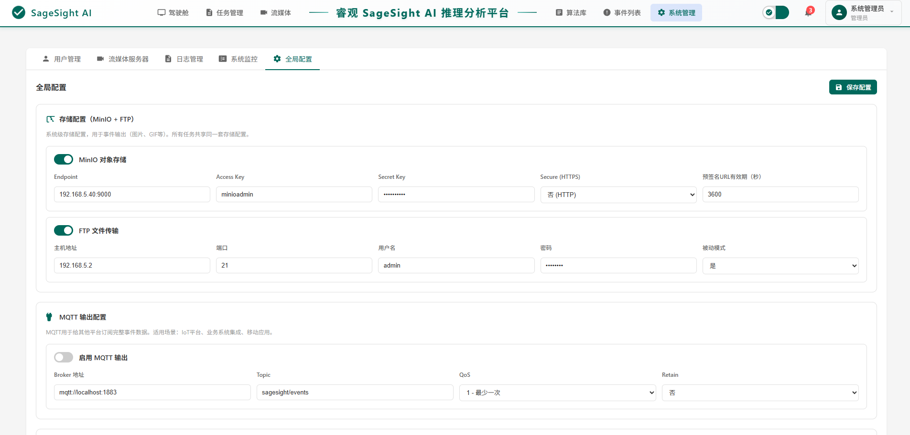
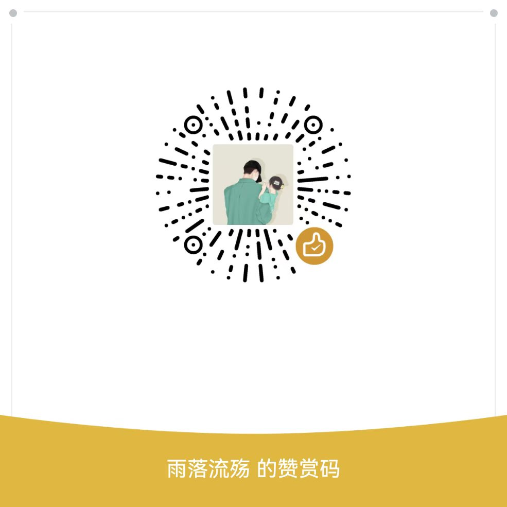

# 睿观 SageSight AI 推理分析平台

[English](README_EN.md) | 中文

## 项目简介

睿观 SageSight AIOT项目是一个包含：睿观 SageSight cloud 云平台（负责物联网、业务系统、租户管理）、睿观 SageSight edge 边缘设备（负责视频采集、分析、存储）、睿观 SageSight lab 标注训练平台和睿观 SageSight AI 推理分析平台组成，本项目是睿观 SageSight AI 推理分析平台，一款智能视频分析平台，基于深度学习技术实现实时目标检测、跟踪和事件分析。支持多平台硬件加速（NVIDIA GPU、CPU、RK3588 NPU），适用于安防监控、智能交通、工业检测等多种小场景，其中流媒体接入、PTZ、对讲只是为了满足小场景需求单用该项目额外添加的功能，不要要求太高，实际使用中只需要任务管理和推理，由边缘平台管理的，我不认识代码，都是AI编写，重要事情说三遍！

## 核心功能

### 1. 多路视频实时分析
- **多任务并发**：同时运行多个检测任务，每个任务可关联多路摄像机通道
- **多路并发处理**：单任务内多路摄像机并行解码与检测，共享同一算法模型
- **硬件加速解码**：支持 NVIDIA CUDA、Intel QSV、RK3588 MPP 等硬件加速解码
- **灵活的视频源**：支持 RTSP 实时流、本地视频文件（mp4/avi/mkv 等）、HTTP 流
- **多协议接入**：支持 ONVIF、RTSP等接入协议，跨网段扫描

### 2. 智能目标检测与跟踪
- **实时目标检测**：基于 YOLOv8/YOLO11 模型，实现高精度目标检测
- **多推理后端**：支持 onnx_cuda、onnx_cpu、onnx_tensorrt、tensorrt、rknn 五种后端
- **全局检测进程池**：检测器进程池架构，多任务共享 GPU 资源，避免重复加载模型
- **多目标跟踪**：采用 Norfair 算法，实现稳定的多目标跟踪与轨迹记录
- **运动检测**：帧差法 + 高斯背景建模，精确检测运动目标，可独立开关
- **类别过滤**：target_classes 动态配置检测目标类别，不指定时检测所有类别

### 3. 区域检测（Zone Detection）
- **多边形区域绘制**：在画面上绘制任意多边形检测区域（归一化坐标存储）
- **必需区域过滤**：对象须至少进入一个必需区域才触发事件，有效减少误报
- **进入/离开事件**：目标进入或离开区域时触发事件
- **徘徊检测**：目标在区域内停留超过阈值时间触发徘徊告警
- **对象白名单**：每个区域可单独配置关注的对象类型
- **进入惯性过滤**：连续 N 帧确认进入区域，过滤边缘抖动

### 4. 事件智能分析与输出
- **事件生命周期**：完整管理 track_start / track_update / track_end 事件流程
- **多种事件类型**：跟踪事件、区域入侵、徘徊告警等
- **事件 GIF 动画**：基于帧缓存生成事件过程 GIF，支持 pre/post 时间窗口、轨迹绘制
- **三通道存储**：本地、MinIO、FTP 三种存储方式独立开关（图片与 GIF 分开控制）
- **异步 I/O 输出**：图片上传、MQTT 推送、数据库保存等 I/O 操作线程池异步执行，不阻塞检测管道
- **事件过滤**：按置信度阈值、目标类别过滤事件
- **关键帧采集**：支持 full / cropped / keyframe / periodic 四种采集策略
- **图片压缩**：JPEG 质量与尺寸可配置，降低存储与带宽占用
- **事件自动清理**：后台线程按保留天数定期清理过期事件及对应存储文件（本地/MinIO/FTP）

### 5. 电视墙实时监控
- **多路视频墙**：支持多路视频同时显示，实时查看监控画面
- **AI 视频流**：实时推送叠加检测框、跟踪框、轨迹、区域的 AI 分析画面
- **实时事件列表**：右侧显示最新事件，点击查看详细信息
- **图片/GIF 切换**：事件详情支持关键帧图片和 GIF 动画切换显示
- **语音双向对讲**：基于 ONVIF Audio Back Channel 协议实现跨品牌语音双向对讲

### 6. 流媒体管理
- **摄像机管理**：支持 ONVIF 协议自动发现、网络扫描和设备管理
- **PTZ 控制**：支持云台方向控制、预置位保存/调用、变倍变焦（连续/相对/绝对移动）
- **PTZ 自动跟踪**：基于跟踪目标位置自动驱动云台跟随（autotrack）
- **巡航路径**：支持预置位巡航路径配置与执行
- **设备通道池**：支持设备通道池管理，一个通道可被多任务复用，通道级 Zone 配置
- **目录管理**：支持摄像机目录树结构，便于分类管理

### 7. 语音对讲
- **ONVIF Audio Back Channel**：基于 ONVIF 标准协议实现跨品牌双向语音对讲
- **品牌兼容**：支持海康威视、大华、宇视、天地伟业等 ONVIF 认证摄像机
- **音频增强**：支持音量增益、音频编码（PCMU/PCMA）等参数配置

### 8. AI 任务管理
- **多模块配置**：支持解码器、检测器、跟踪器、运动检测、事件输出独立配置
- **功能开关**：运动检测、跟踪功能可独立开关
- **实时启停**：支持任务实时启动和停止，灵活控制分析进程
- **性能监控**：实时显示解码、检测、跟踪各阶段耗时、FPS、检测目标数等指标
- **配置模板**：支持算法配置模板，快速创建新任务

### 9. 算法管理
- **算法配置**：支持 YOLOv8/YOLO11 等多种算法配置
- **模型管理**：支持模型文件上传和管理
- **一模型一标签**：每个模型对应独立标签文件，动态加载，且支持中文标签
- **示例图片**：算法配置支持示例图片展示

### 10. 系统管理
- **硬件监控**：实时监控 CPU、内存、GPU 使用情况
- **解码器配置**：支持解码器硬件加速方式配置
- **流媒体配置**：支持 ZLMediaKit 流媒体服务器配置
- **远程存储配置**：支持 MinIO、FTP 远程存储配置
- **事件清理配置**：支持事件保留天数、清理间隔配置

### 11. 实时通信
- **Socket.IO 实时推送**：事件信息实时推送到前端，无需刷新页面（namespace: `/ws`）
- **原生 WebSocket 通道**：提供标准 WebSocket 端点（`/ws/raw`），供第三方系统接入
- **MQTT 事件推送**：事件通过 MQTT 协议推送到 EMQX/驾驶舱

## 功能截图展示

### 登录页面

简洁现代的登录界面，支持用户认证和安全登录。

### 驾驶舱（电视墙）

多路视频实时监控，右侧显示最新事件列表，支持实时查看和分析结果。

### 任务管理

灵活的AI任务管理界面，支持任务的创建、编辑、启停和性能监控。

### 任务配置

详细的任务配置对话框，支持解码器、检测器、跟踪器、事件输出等多模块配置。

### 区域配置

区域检测配置界面，支持在画面上绘制多边形检测区域，可设置必需区域、徘徊检测、对象类型白名单等规则，实现精准区域监控。

### 事件管理

事件查询和管理界面，支持按任务、类型、类别筛选，查看事件详情和GIF动画。

### 事件详情

事件详情对话框，支持关键帧图片和GIF动画切换显示，完整查看事件信息。

### 播放对话框

视频播放对话框，支持实时流播放和语音双向对讲功能。

### 流媒体设备管理

摄像机管理界面，支持ONVIF自动发现、PTZ控制、设备通道池管理。

### 算法库

算法配置管理界面，支持YOLOv8/YOLO11等算法配置，模型管理和类别配置。

### 系统管理

系统配置和监控界面，支持硬件监控、解码器配置、流媒体服务器配置。

## 技术特性

### 多平台硬件加速
- **NVIDIA GPU**：CUDA、TensorRT 加速推理，RTX 2070 达到 30+ FPS
- **CPU 推理**：ONNX Runtime 纯 CPU 推理，适合无 GPU 环境
- **RK3588 NPU**：RKNN 加速推理，适合嵌入式边缘计算设备

### 高性能架构
- **零拷贝传输**：共享内存零拷贝帧传输，降低 CPU 开销
- **环形缓冲区**：环形缓冲区 + 索引队列架构，实现高效帧缓存
- **多进程架构**：解码、检测、跟踪、事件处理独立进程，充分利用多核 CPU
- **全局检测进程池**：检测器进程池统一管理 GPU 资源，多任务共享模型实例

### 统一日志管理
- **多进程日志收集**：子进程通过 QueueHandler 将日志发送到主进程 QueueListener，统一写入文件
- **日志轮转**：按大小自动轮转，支持备份数与控制台输出配置
- **单一配置源**：日志级别、格式、文件路径等统一从 `system_config.yaml` 读取

## 快速启动

### 1. 环境准备

**Python 环境**：
- Python 3.11+
- pip 包管理器

**硬件环境（可选）**：
- NVIDIA GPU：CUDA 12.x + CuDNN 8.9+
- RK3588 平台：RKNN Toolkit2

### 2. 安装依赖

**NVIDIA GPU 平台**：
```bash
pip install -r requirements.txt
```

**CPU 平台**：
```bash
# 安装依赖后，将 requirements.txt 中的 onnxruntime-gpu 替换为 onnxruntime
pip install -r requirements.txt
```

**RK3588 平台**：
```bash
pip install -r requirements.txt
# 需手动安装 rknn-toolkit2（瑞芯微官方SDK）
```

### 3. 配置文件

**核心配置文件**（`config/` 目录）：
- `system_config.yaml`：系统配置（Web服务端口、硬件加速、存储配置）
- `detector_config.yaml`：检测器配置（推理后端、阈值）
- `decoder_config.yaml`：解码器配置（硬件加速）
- `event_output.yaml`：事件输出配置（GIF、存储方式）
- `tracker_config.yaml`：跟踪器配置（Norfair 参数）
- `motion_config.yaml`：运动检测配置

**推理后端选择**：
- `onnx_cuda`：CUDA 加速推理（推荐 NVIDIA GPU）
- `onnx_cpu`：纯 CPU 推理（无 GPU 环境）
- `onnx_tensorrt`：TensorRT EP 加速（高性能）
- `tensorrt`：直接加载 TensorRT Engine
- `rknn`：RKNN NPU 推理（RK3588 平台）

### 4. 启动服务

**启动 Web 服务**：
```bash
python run.py
```

**访问平台**：
- 打开浏览器访问：`http://localhost:5556`
- 默认用户名：`admin`
- 默认密码：`admin123`

### 5. 快速配置

**第一步：配置摄像机**
- 进入"流媒体"页面
- 点击"ONVIF发现"自动搜索网络摄像机
- 或手动添加 RTSP 流地址

**第二步：配置算法**
- 进入"算法管理"页面
- 点击"添加算法配置"
- 选择 YOLOv8/YOLO11 模型
- 配置检测类别和阈值

**第三步：创建任务**
- 进入"任务管理"页面
- 点击"添加任务"
- 选择摄像机通道和算法配置
- 配置事件输出方式（本地/MinIO/FTP）
- 启动任务

**第四步：查看分析结果**
- 进入"电视墙"页面
- 实时查看多路监控画面
- 右侧显示最新事件列表
- 点击事件查看详细信息和 GIF 动画

### 6. 部署说明

**推荐使用 phpStudy 管理数据库和 FTP：**

phpStudy 是一款集成了 Apache/Nginx、MySQL/MariaDB、FTP 等服务的一键式服务器管理工具，非常适合本地开发和部署：

1. **下载地址**：[https://www.xp.cn/download.html](https://www.xp.cn/download.html)
2. **安装配置**：
   - 安装后启动 MySQL 服务，用于管理数据库
   - 启动 FTP 服务，用于远程存储事件图片和 GIF
   - 默认端口：MySQL 3306，FTP 21
3. **配置连接**：
   - 在 `config/system_config.yaml` 中配置 FTP 连接信息
   - 在 `config/system_config.yaml` 中配置 MinIO 连接信息（可选）

**ZLMediaKit 流媒体服务器配置：**

本项目使用 ZLMediaKit 作为流媒体服务器，支持 RTSP/RTMP/HTTP-FLV/HLS/WebRTC 等协议。配置文件参考：[docs/流媒体服务器参数配置.MD](docs/流媒体服务器参数配置.MD)

**关键配置说明：**
- **API 配置**：`api.secret` 设置 API 密钥
- **HTTP 服务**：默认端口 88，支持跨域访问
- **RTSP 服务**：默认端口 554，支持直接代理
- **RTMP 服务**：默认端口 1935
- **RTC 服务**：默认端口 8000，支持 WebRTC 语音对讲
- **钩子配置**：配置回调地址，用于流媒体事件通知

**配置文件路径**：将配置文件保存为 `config.ini` 放在 ZLMediaKit 目录下，启动服务即可。

**启动命令**（Windows）：
```bash
MediaServer.exe
```

**启动命令**（Linux）：
```bash
./MediaServer
```

### 语音对讲使用说明（非 localhost 访问）

语音对讲使用浏览器 `getUserMedia` API（麦克风访问），该 API 要求**安全上下文（Secure Context）**。浏览器规则：

- ✅ `https://` 任意地址 → 安全
- ✅ `http://localhost` → 浏览器特殊豁免（视为安全）
- ❌ `http://192.168.x.x` → 非安全，浏览器拒绝调用 `getUserMedia`

因此 `http://localhost:5556` 能用、`http://网络IP:5556` 不能用——这是**浏览器安全策略**，非后端代码限制。

**解决方法**：让浏览器把你的 HTTP 地址"视为安全来源"：

1. 浏览器地址栏打开 `chrome://flags/#unsafely-treat-insecure-origin-as-secure`
2. 在输入框填入平台地址，如 `http://192.168.5.15:5556`（你的平台 IP 地址）
3. 右侧下拉选 **Enabled** → 点 **Relaunch** 重启浏览器
4. 重新访问 `http://192.168.5.15:5556` → `isSecureContext` 变为 `true` → 麦克风可用

## 应用场景

### 安防监控
- 入侵检测：自动检测入侵人员，生成事件 GIF
- 异常行为：检测异常行为，实时报警
- 区域监控：自定义监控区域，精准检测

### 智能交通
- 车辆检测：实时检测车辆，统计车流量
- 违章检测：检测违章停车、逆行等行为
- 人流统计：统计人员流动，分析人流密度

### 工业检测
- 安全监测：检测人员是否佩戴安全装备
- 设备监控：检测设备运行状态
- 质量检测：检测产品缺陷和质量问题

## 项目架构

```
sagesight-AI/
├── config/              # 配置文件目录
│   ├── system_config.yaml    # 系统配置（Web服务、硬件加速、存储、通信）
│   ├── detector_config.yaml  # 检测器配置（推理后端、阈值）
│   ├── decoder_config.yaml   # 解码器配置（硬件加速）
│   ├── event_output.yaml     # 事件输出配置（GIF、存储方式、推送）
│   ├── tracker_config.yaml   # 跟踪器配置（Norfair参数）
│   ├── motion_config.yaml    # 运动检测配置
│   └── display_config.yaml   # 显示配置
├── src/                 # 源代码目录
│   ├── decoders/        # 视频解码器
│   │   ├── __init__.py
│   │   └── video_decoder.py
│   ├── detection/       # 区域检测
│   │   ├── __init__.py
│   │   └── zone_manager.py     # Zone 区域管理器
│   ├── pipeline/        # 检测管道
│   │   ├── __init__.py
│   │   └── camera_pipeline.py
│   ├── detectors/       # 目标检测器
│   │   ├── __init__.py
│   │   ├── base.py             # 检测器基类
│   │   ├── factory.py          # 检测器工厂
│   │   ├── detector_pool.py    # 检测器进程池管理
│   │   ├── detector_process.py # 检测器进程
│   │   ├── remote_detector.py  # 远程检测器代理
│   │   ├── region_utils.py     # 区域检测工具
│   │   └── backends/           # 推理后端
│   │       ├── onnx_cpu.py     # ONNX CPU 后端
│   │       ├── onnx_cuda.py    # ONNX CUDA 后端
│   │       ├── onnx_tensorrt.py # ONNX TensorRT 后端
│   │       ├── tensorrt.py     # TensorRT 直接加载
│   │       └── rknn.py         # RKNN NPU 后端
│   ├── tracking/        # 目标跟踪器
│   │   ├── __init__.py
│   │   ├── norfair_tracker.py  # Norfair 跟踪器
│   │   ├── tracked_object.py   # 跟踪对象
│   │   └── ptz_metrics.py      # PTZ 度量
│   ├── events/          # 事件输出处理
│   │   ├── __init__.py
│   │   ├── event_output.py          # 事件输出（异步 I/O）
│   │   ├── tracked_object_processor.py # 跟踪对象处理器
│   │   ├── event_cleanup_service.py # 事件清理服务
│   │   ├── gif_generator.py         # GIF 生成器
│   │   ├── minio_outputter.py       # MinIO 存储
│   │   ├── ftp_outputter.py         # FTP 存储
│   │   └── mqtt_outputter.py        # MQTT 推送
│   ├── tasks/           # 任务管理
│   │   ├── __init__.py
│   │   ├── task_manager.py               # 任务数据模型
│   │   ├── task_executor.py              # 任务执行器（多摄像机）
│   │   ├── task_api.py                   # 任务 API
│   │   ├── device_channel_pool_manager.py # 设备通道池管理
│   │   └── device_channel_pool_api.py    # 设备通道池 API
│   ├── cameras/         # 摄像机管理
│   │   ├── __init__.py
│   │   ├── camera_manager.py        # 摄像机管理器
│   │   ├── camera_api.py            # 摄像机 API
│   │   ├── stream_service.py        # 流媒体服务
│   │   ├── stream_api.py            # 流媒体 API
│   │   ├── ptz_service.py           # PTZ 服务
│   │   ├── ptz_api.py               # PTZ API
│   │   ├── directory_service.py     # 目录服务
│   │   ├── directory_api.py         # 目录 API
│   │   ├── audio_talk_service_onvif.py # ONVIF 语音对讲
│   │   ├── audio_talk_api.py        # 语音对讲 API
│   │   ├── onvif_client.py          # ONVIF 客户端
│   │   └── onvif_audio_backchannel.py # ONVIF 音频回通道
│   ├── algorithms/      # 算法管理
│   │   ├── __init__.py
│   │   ├── algorithm_manager.py  # 算法管理器
│   │   ├── algorithm_api.py      # 算法 API
│   │   ├── algorithm_factory.py  # 算法工厂
│   │   └── model_manager.py      # 模型管理
│   ├── system/          # 系统管理
│   │   ├── __init__.py
│   │   ├── system_manager.py     # 系统管理器（流媒体配置）
│   │   ├── system_api.py         # 系统 API
│   │   └── system_config_loader.py # 配置加载器
│   ├── auth/            # 用户认证
│   │   ├── __init__.py
│   │   ├── auth_manager.py  # 认证管理器
│   │   └── auth_api.py      # 认证 API
│   ├── motion/          # 运动检测
│   │   ├── __init__.py
│   │   └── improved_motion.py  # 改进运动检测器
│   └── utils/           # 工具类
│       ├── __init__.py
│       ├── log_manager.py         # 统一日志管理器
│       ├── process.py             # 进程管理（BaseProcess/Process）
│       ├── shared_memory.py       # 共享内存
│       ├── frame_index_queue.py   # 帧索引队列
│       ├── image.py               # YUV 图像处理
│       ├── cuda_processor.py      # CUDA 处理器
│       ├── rga_processor.py       # RGA 处理器（RK3588）
│       ├── rknn_executor.py       # RKNN 执行器
│       ├── ffmpeg_presets.py      # FFmpeg 预设
│       ├── font_utils.py          # 字体工具
│       ├── platform_utils.py      # 平台工具
│       └── video_utils.py         # 视频工具
├── static/              # 静态资源
│   ├── css/             # 样式文件
│   ├── js/              # JavaScript 文件
│   │   ├── jessibuca/    # 视频播放器
│   │   └── h265web/      # H265解码
│   └── images/          # 图片资源
│       └── algorithms/  # 算法示例图片
├── templates/           # HTML 模板
│   ├── base.html        # 基础布局模板
│   ├── login.html       # 登录页面
│   ├── monitor.html     # 电视墙页面
│   ├── tasks.html       # 任务管理页面
│   ├── cameras.html     # 摄像机管理页面
│   ├── events.html      # 事件管理页面
│   ├── algorithms.html  # 算法库页面
│   └── system.html      # 系统管理页面
├── models/              # 模型文件目录
│   ├── detection/       # 检测模型
│   └── labels/          # 标签文件
├── data/                # 数据文件
│   └── tasks.db         # SQLite 数据库
├── docs/                # 文档目录
│   └── images/          # 功能截图
├── logs/                # 日志文件
├── output/              # 输出文件（图片、GIF）
├── requirements.txt     # Python 依赖清单
└── run.py               # 启动脚本
```

## 更新日志

### v2.0.0（当前版本）
- ✅ 完整支持多平台推理（NVIDIA GPU、CPU、RK3588 NPU）
- ✅ 完善事件 GIF 生成和三通道存储（本地、MinIO、FTP）
- ✅ 电视墙和事件管理支持图片/GIF 切换显示
- ✅ ONVIF Audio Back Channel 语音双向对讲（跨品牌兼容）
- ✅ ONVIF 协议自动发现和 PTZ 控制
- ✅ 多路视频实时分析和多目标跟踪（Norfair）
- ✅ 实时事件推送（Socket.IO + 原生 WebSocket + MQTT）
- ✅ 事件输出异步 I/O 优化（线程池执行存储/推送，不阻塞检测管道）
- ✅ 事件自动清理（按保留天数定期清理过期事件及存储文件）
- ✅ 统一日志管理（多进程 QueueHandler + QueueListener 架构）

## 技术支持

**项目地址**：https://gitee.com/hanx125/sagesight-ai

**技术栈**：
- 后端：Python + Flask + SocketIO + Eventlet
- 前端：HTML + CSS + JavaScript
- 推理：ONNX Runtime + TensorRT + RKNN
- 解码：FFmpeg + 硬件加速
- 存储：SQLite + MinIO + FTP
- 通信：Socket.IO + 原生 WebSocket + MQTT
- 语音对讲：ONVIF Audio Back Channel

## 许可证

本项目仅供学习和研究使用，不需授权即可用于商业用途，但不得申请软件专利著作权。

---

**睿观 SageSight AI** - 智能视频分析，让监控更智慧

---

## 联系作者
### 电子邮箱

624662795@qq.com

### 添加微信

如果您有技术问题或合作需求，欢迎添加作者微信交流：


### 赞赏支持

如果您觉得这个项目对您有帮助，欢迎赞赏支持作者继续开发：

