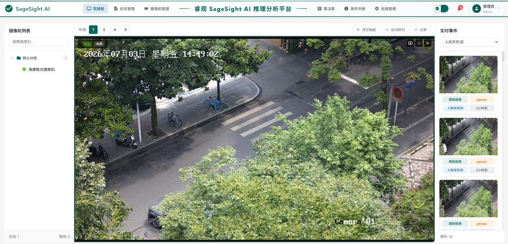
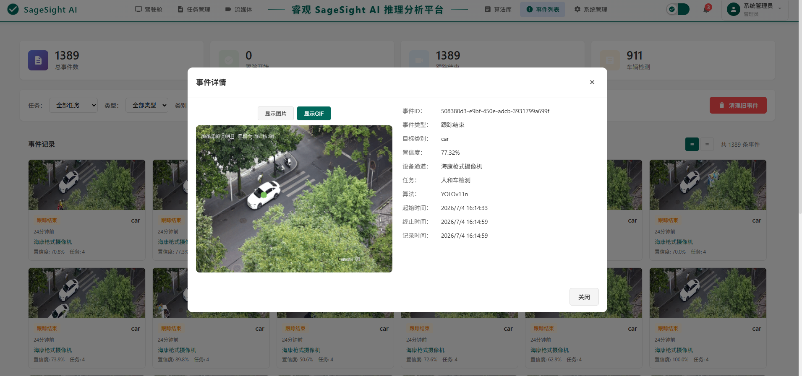
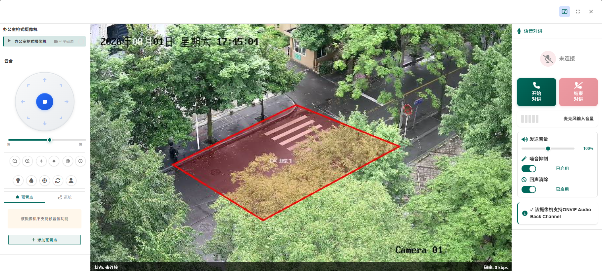
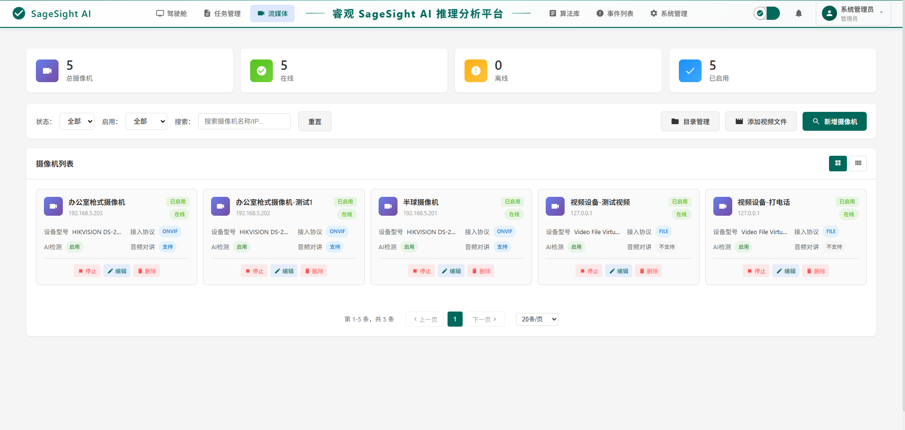

# 睿观 SageSight AI 推理分析平台

## 项目简介

睿观 SageSight AIOT项目是一个包含：睿观 SageSight cloud 云平台（负责物联网、业务系统、租户管理）、睿观 SageSight edge 边缘设备（负责视频采集、分析、存储）、睿观 SageSight lab 标注训练平台和睿观 SageSight AI 推理分析平台组成，本项目是睿观 SageSight AI 推理分析平台，一款智能视频分析平台，基于深度学习技术实现实时目标检测、跟踪和事件分析。支持多平台硬件加速（NVIDIA GPU、CPU、RK3588 NPU），适用于安防监控、智能交通、工业检测等多种小场景，其中流媒体接入、PTZ、对讲只是为了满足小场景需求单用该项目额外添加的功能，不要要求太高，实际使用中只需要任务管理和推理，由边缘平台管理的，我不认识代码，都是AI编写，重要事情说三遍！

## 核心功能

### 1. 多路视频实时分析
- **多路并发处理**：支持多路摄像机同时进行实时检测分析
- **硬件加速解码**：支持 NVIDIA CUDA、Intel QSV、RK3588 MPP 等硬件加速解码
- **灵活的视频源**：支持 RTSP 实时流、本地视频文件、HTTP 流等多种视频源

### 2. 智能目标检测与跟踪
- **实时目标检测**：基于 YOLOv8/YOLO11 模型，实现高精度目标检测
- **多目标跟踪**：采用 BoT-SORT 算法，实现稳定的多目标跟踪
- **运动检测**：智能背景建模和帧差法，精确检测运动目标
- **类别过滤**：支持自定义检测目标类别（人员、车辆、动物等）

### 3. 事件智能分析与输出
- **自动事件触发**：基于置信度阈值自动触发事件记录
- **事件 GIF 动画**：自动生成事件过程 GIF 动画，完整记录事件轨迹
- **三通道存储**：本地存储、MinIO 云存储、FTP 远程存储三种方式
- **实时事件推送**：WebSocket 实时推送事件信息到前端显示

### 4. 电视墙实时监控
- **多路视频墙**：支持多路视频同时显示，实时查看监控画面
- **实时事件列表**：右侧显示最新事件，点击查看详细信息
- **图片/GIF 切换**：事件详情支持关键帧图片和 GIF 动画切换显示
- **语音双向对讲**：支持 WebRTC 语音双向对讲，实时沟通

### 5. 流媒体管理
- **摄像机管理**：支持 ONVIF 协议自动发现和设备管理
- **PTZ 控制**：支持云台转动、预置位调用、变倍变焦等 PTZ 操作
- **设备通道池**：支持设备通道池管理，灵活绑定多任务
- **目录管理**：支持摄像机目录树结构，便于分类管理

### 6. AI 任务管理
- **任务配置**：支持解码器、检测器、跟踪器、事件输出等多模块配置
- **配置模板**：支持算法配置模板，快速创建新任务
- **实时启停**：支持任务实时启动和停止，灵活控制分析进程
- **性能监控**：实时显示任务运行状态和性能指标

### 7. 算法管理
- **算法配置**：支持 YOLOv8/YOLO11 等多种算法配置
- **模型管理**：支持模型文件上传和管理
- **类别配置**：支持检测类别和标签文件配置
- **示例图片**：算法配置支持示例图片展示

### 8. 系统管理
- **硬件监控**：实时监控 CPU、内存、GPU 使用情况
- **解码器配置**：支持解码器硬件加速方式配置
- **流媒体配置**：支持 ZLMediaKit 流媒体服务器配置
- **远程存储配置**：支持 MinIO、FTP 远程存储配置

## 功能截图展示

### 登录页面

简洁现代的登录界面，支持用户认证和安全登录。

### 驾驶舱（电视墙）

多路视频实时监控，右侧显示最新事件列表，支持实时查看和分析结果。

### 任务管理

灵活的AI任务管理界面，支持任务的创建、编辑、启停和性能监控。

### 任务配置

详细的任务配置对话框，支持解码器、检测器、跟踪器、事件输出等多模块配置。

### 事件管理

事件查询和管理界面，支持按任务、类型、类别筛选，查看事件详情和GIF动画。

### 事件详情

事件详情对话框，支持关键帧图片和GIF动画切换显示，完整查看事件信息。

### 播放对话框

视频播放对话框，支持实时流播放和语音双向对讲功能。

### 流媒体设备管理

摄像机管理界面，支持ONVIF自动发现、PTZ控制、设备通道池管理。

### 算法库

算法配置管理界面，支持YOLOv8/YOLO11等算法配置，模型管理和类别配置。

### 系统管理

系统配置和监控界面，支持硬件监控、解码器配置、流媒体服务器配置。

## 技术特性

### 多平台硬件加速
- **NVIDIA GPU**：CUDA、TensorRT 加速推理，RTX 2070 达到 30+ FPS
- **CPU 推理**：ONNX Runtime 纯 CPU 推理，适合无 GPU 环境
- **RK3588 NPU**：RKNN 加速推理，适合嵌入式边缘计算设备

### 高性能架构
- **零拷贝传输**：共享内存零拷贝帧传输，降低 CPU 开销
- **环形缓冲区**：环形缓冲区 + 索引队列架构，实现高效帧缓存
- **多进程架构**：解码、检测、跟踪、输出独立进程，充分利用多核 CPU

### 实时通信
- **WebSocket 实时推送**：事件信息实时推送到前端，无需刷新页面
- **WebRTC 语音对讲**：支持双向语音对讲，实时沟通
- **SocketIO 事件广播**：任务状态、事件信息实时广播

## 快速启动

### 1. 环境准备

**Python 环境**：
- Python 3.11+
- pip 包管理器

**硬件环境（可选）**：
- NVIDIA GPU：CUDA 12.x + CuDNN 8.9+
- RK3588 平台：RKNN Toolkit2

### 2. 安装依赖

**NVIDIA GPU 平台**：
```bash
pip install -r requirements.txt
```

**CPU 平台**：
```bash
pip install onnxruntime numpy opencv-python scipy pyyaml flask flask-socketio pillow imageio
```

**RK3588 平台**：
```bash
pip install -r requirements.txt
# 需手动安装 rknn-toolkit2（瑞芯微官方SDK）
```

### 3. 配置文件

**核心配置文件**（`config/` 目录）：
- `system_config.yaml`：系统配置（Web服务端口、硬件加速、存储配置）
- `detector_config.yaml`：检测器配置（推理后端、阈值）
- `decoder_config.yaml`：解码器配置（硬件加速）
- `event_output.yaml`：事件输出配置（GIF、存储方式）
- `tracker_config.yaml`：跟踪器配置（BoT-SORT参数）
- `motion_config.yaml`：运动检测配置

**推理后端选择**：
- `onnx_cuda`：CUDA 加速推理（推荐 NVIDIA GPU）
- `onnx_cpu`：纯 CPU 推理（无 GPU 环境）
- `onnx_tensorrt`：TensorRT EP 加速（高性能）
- `tensorrt`：直接加载 TensorRT Engine
- `rknn`：RKNN NPU 推理（RK3588 平台）

### 4. 启动服务

**启动 Web 服务**：
```bash
python run.py
```

**访问平台**：
- 打开浏览器访问：`http://localhost:5555`
- 默认用户名：`admin`
- 默认密码：`admin123`

### 5. 快速配置

**第一步：配置摄像机**
- 进入"流媒体"页面
- 点击"ONVIF发现"自动搜索网络摄像机
- 或手动添加 RTSP 流地址

**第二步：配置算法**
- 进入"算法管理"页面
- 点击"添加算法配置"
- 选择 YOLOv8/YOLO11 模型
- 配置检测类别和阈值

**第三步：创建任务**
- 进入"任务管理"页面
- 点击"添加任务"
- 选择摄像机通道和算法配置
- 配置事件输出方式（本地/MinIO/FTP）
- 启动任务

**第四步：查看分析结果**
- 进入"电视墙"页面
- 实时查看多路监控画面
- 右侧显示最新事件列表
- 点击事件查看详细信息和 GIF 动画

### 6. 部署说明

**推荐使用 phpStudy 管理数据库和 FTP：**

phpStudy 是一款集成了 Apache/Nginx、MySQL/MariaDB、FTP 等服务的一键式服务器管理工具，非常适合本地开发和部署：

1. **下载地址**：[https://www.xp.cn/download.html](https://www.xp.cn/download.html)
2. **安装配置**：
   - 安装后启动 MySQL 服务，用于管理数据库
   - 启动 FTP 服务，用于远程存储事件图片和 GIF
   - 默认端口：MySQL 3306，FTP 21
3. **配置连接**：
   - 在 `config/system_config.yaml` 中配置 FTP 连接信息
   - 在 `config/system_config.yaml` 中配置 MinIO 连接信息（可选）

**ZLMediaKit 流媒体服务器配置：**

本项目使用 ZLMediaKit 作为流媒体服务器，支持 RTSP/RTMP/HTTP-FLV/HLS/WebRTC 等协议。配置文件参考：[docs/流媒体服务器参数配置.MD](docs/流媒体服务器参数配置.MD)

**关键配置说明：**
- **API 配置**：`api.secret` 设置 API 密钥
- **HTTP 服务**：默认端口 88，支持跨域访问
- **RTSP 服务**：默认端口 554，支持直接代理
- **RTMP 服务**：默认端口 1935
- **RTC 服务**：默认端口 8000，支持 WebRTC 语音对讲
- **钩子配置**：配置回调地址，用于流媒体事件通知

**配置文件路径**：将配置文件保存为 `config.ini` 放在 ZLMediaKit 目录下，启动服务即可。

**启动命令**（Windows）：
```bash
MediaServer.exe
```

**启动命令**（Linux）：
```bash
./MediaServer
```

## 应用场景

### 安防监控
- 入侵检测：自动检测入侵人员，生成事件 GIF
- 异常行为：检测异常行为，实时报警
- 区域监控：自定义监控区域，精准检测

### 智能交通
- 车辆检测：实时检测车辆，统计车流量
- 违章检测：检测违章停车、逆行等行为
- 人流统计：统计人员流动，分析人流密度

### 工业检测
- 安全监测：检测人员是否佩戴安全装备
- 设备监控：检测设备运行状态
- 质量检测：检测产品缺陷和质量问题

## 项目架构

```
sagesight-AI/
├── config/              # 配置文件目录
│   ├── system_config.yaml    # 系统配置（Web服务、硬件加速、存储）
│   ├── detector_config.yaml  # 检测器配置（推理后端、阈值）
│   ├── decoder_config.yaml   # 解码器配置（硬件加速）
│   ├── event_output.yaml     # 事件输出配置（GIF、存储方式）
│   ├── tracker_config.yaml   # 跟踪器配置（BoT-SORT参数）
│   ├── motion_config.yaml    # 运动检测配置
│   └── display_config.yaml   # 显示配置
├── src/                 # 源代码目录
│   ├── decoders/        # 视频解码器
│   │   ├── __init__.py
│   │   └── video_decoder.py
│   ├── detectors/       # 目标检测器
│   │   ├── __init__.py
│   │   ├── yolo_detector.py
│   │   ├── motion_detector.py
│   │   └── preprocessor.py
│   ├── tracking/        # 目标跟踪器
│   │   ├── __init__.py
│   │   └── botsort/
│   │       ├── __init__.py
│   │       ├── botsort_tracker.py
│   │       ├── kalman_filter_h.py
│   │       ├── reid_extractor.py
│   │       └── track.py
│   ├── events/          # 事件输出处理
│   │   ├── __init__.py
│   │   ├── event_output.py
│   │   ├── gif_generator.py
│   │   ├── minio_outputter.py
│   │   ├── ftp_outputter.py
│   │   ├── mqtt_outputter.py
│   │   └── websocket_outputter.py
│   ├── tasks/           # 任务管理
│   │   ├── __init__.py
│   │   ├── task_manager.py
│   │   ├── task_executor.py
│   │   ├── task_api.py
│   │   ├── device_channel_pool_manager.py
│   │   └── device_channel_pool_api.py
│   ├── cameras/         # 摄像机管理
│   │   ├── __init__.py
│   │   ├── camera_manager.py
│   │   ├── camera_api.py
│   │   ├── stream_service.py
│   │   ├── stream_api.py
│   │   ├── ptz_service.py
│   │   ├── ptz_api.py
│   │   ├── directory_service.py
│   │   ├── directory_api.py
│   │   ├── audio_talk_service_onvif.py
│   │   ├── audio_talk_api.py
│   │   ├── onvif_client.py
│   │   └── onvif_audio_backchannel.py
│   ├── algorithms/      # 算法管理
│   │   ├── __init__.py
│   │   ├── algorithm_manager.py
│   │   ├── algorithm_api.py
│   │   ├── algorithm_factory.py
│   │   └── model_manager.py
│   ├── system/          # 系统管理
│   │   ├── __init__.py
│   │   ├── system_manager.py
│   │   └── system_api.py
│   ├── auth/            # 用户认证
│   │   ├── __init__.py
│   │   ├── auth_manager.py
│   │   └── auth_api.py
│   └── utils/           # 工具类
│       ├── __init__.py
│       ├── frame_queue.py
│       ├── frame_index_queue.py
│       ├── shared_memory.py
│       ├── shared_memory_ring_buffer.py
│       └── rknn_executor.py
├── static/              # 静态资源
│   ├── css/             # 样式文件
│   │   ├── style.css
│   │   ├── audio-talk.css
│   │   └── nipplejs-ptz.css
│   ├── js/              # JavaScript 文件
│   │   ├── main.js
│   │   ├── tasks.js
│   │   ├── cameras.js
│   │   ├── monitor.js
│   │   ├── algorithms.js
│   │   ├── system.js
│   │   ├── audio_talk.js
│   │   ├── audio_talk_onvif.js
│   │   ├── ptz_joystick.js
│   │   ├── config_modal.js
│   │   ├── ZLMRTCClient.js
│   │   ├── jessibuca/    # 视频播放器
│   │   └── h265web/      # H265解码
│   └── images/          # 图片资源
│       └── algorithms/  # 算法示例图片
├── templates/           # HTML 模板
│   ├── base.html        # 基础布局模板
│   ├── login.html       # 登录页面
│   ├── monitor.html     # 电视墙页面
│   ├── tasks.html       # 任务管理页面
│   ├── cameras.html     # 摄像机管理页面
│   ├── events.html      # 事件管理页面
│   ├── algorithms.html  # 算法库页面
│   └── system.html      # 系统管理页面
├── models/              # 模型文件目录
│   ├── detection/       # 检测模型
│   ├── labels/          # 标签文件
│   └── coco_labels.txt  # COCO类别标签
├── data/                # 数据文件
│   ├── sagesight.db     # SQLite 数据库
│   └── tasks.db         # 任务数据库
├── docs/                # 文档目录
│   ├── images/          # 功能截图
│   ├── 参数配置说明.md
│   ├── video_decoder_documentation.md
│   ├── BoT-SORT_Integration_Guide.md
│   ├── SHARED_MEMORY_FRAME_QUEUE_ARCHITECTURE.md
│   ├── MULTIPROCESS_OPTIMIZATION.md
│   └── yolo_detection_channel_development_plan.md
├── examples/            # 示例代码
├── scripts/             # 辅助脚本
├── tests/               # 测试脚本
├── logs/                # 日志文件
├── output/              # 输出文件（图片、GIF）
├── requirements.txt     # Python 依赖清单
└── run.py               # 启动脚本
```

## 更新日志

### v1.0.0（当前版本）
- ✅ 完整支持多平台推理（NVIDIA GPU、CPU、RK3588 NPU）
- ✅ 完善事件 GIF 生成和三通道存储（本地、MinIO、FTP）
- ✅ 电视墙和事件管理支持图片/GIF 切换显示
- ✅ WebRTC 语音双向对讲功能
- ✅ ONVIF 协议自动发现和 PTZ 控制
- ✅ 多路视频实时分析和多目标跟踪
- ✅ 实时事件推送和 WebSocket 广播

## 技术支持

**项目地址**：https://gitee.com/hanx125/sagesight-ai

**技术栈**：
- 后端：Python + Flask + SocketIO
- 前端：HTML + CSS + JavaScript
- 推理：ONNX Runtime + TensorRT + RKNN
- 解码：FFmpeg + 硬件加速
- 存储：SQLite + MinIO + FTP
- 通信：WebSocket + WebRTC

## 许可证

本项目仅供学习和研究使用，未经授权不得用于商业用途。

---

**睿观 SageSight AI** - 智能视频分析，让监控更智慧

---

## 联系作者

### 添加微信

如果您有技术问题或合作需求，欢迎添加作者微信交流：


### 赞赏支持

如果您觉得这个项目对您有帮助，欢迎赞赏支持作者继续开发：

