# SageSight AI Inference Analysis Platform

English | [中文](README.md)

## Project Introduction

The SageSight AIoT project consists of: SageSight Cloud (responsible for IoT, business systems, and tenant management), SageSight Edge (responsible for video capture, analysis, and storage), SageSight Lab (annotation and training platform), and SageSight AI Inference Analysis Platform. This repository is the **SageSight AI Inference Analysis Platform** — an intelligent video analysis platform that implements real-time object detection, tracking, and event analysis based on deep learning. It supports multi-platform hardware acceleration (NVIDIA GPU, CPU, RK3588 NPU) and is suitable for small-scale scenarios such as security surveillance, intelligent transportation, and industrial inspection. The streaming access, PTZ, and intercom features are extra additions to meet small-scenario needs — don't expect too much from them. In actual use, only task management and inference are required, managed by the edge platform. I don't understand the code — it's all AI-written. Important things bear repeating!

## Core Features

### 1. Multi-Stream Real-Time Video Analysis
- **Multi-task concurrency**: Run multiple detection tasks simultaneously, each task can associate with multiple camera channels
- **Multi-stream parallel processing**: Multiple cameras within a single task decode and detect in parallel, sharing the same algorithm model
- **Hardware-accelerated decoding**: Supports NVIDIA CUDA, Intel QSV, RK3588 MPP hardware-accelerated decoding
- **Flexible video sources**: Supports RTSP live streams, local video files (mp4/avi/mkv, etc.), HTTP streams
- **Multi-protocol access**: Supports ONVIF, RTSP and other access protocols, cross-subnet scanning

### 2. Intelligent Object Detection and Tracking
- **Real-time object detection**: Based on YOLOv8/YOLO11 models for high-precision object detection
- **Multiple inference backends**: Supports onnx_cuda, onnx_cpu, onnx_tensorrt, tensorrt, rknn — five backends
- **Global detection process pool**: Detector process pool architecture, multiple tasks share GPU resources, avoiding redundant model loading
- **Multi-object tracking**: Uses Norfair algorithm for stable multi-object tracking and trajectory recording
- **Motion detection**: Frame differencing + Gaussian background modeling for precise motion detection, independently toggleable
- **Class filtering**: target_classes dynamically configures detection target classes; detects all classes when unspecified

### 3. Zone Detection
- **Polygon zone drawing**: Draw arbitrary polygon detection zones on the frame (normalized coordinate storage)
- **Required zone filtering**: Objects must enter at least one required zone to trigger an event, effectively reducing false alarms
- **Entry/exit events**: Trigger events when targets enter or leave a zone
- **Loitering detection**: Trigger loitering alarms when targets stay in a zone beyond a threshold time
- **Object whitelist**: Each zone can independently configure object types of interest
- **Entry inertia filtering**: Confirm zone entry over N consecutive frames to filter edge jitter

### 4. Intelligent Event Analysis and Output
- **Event lifecycle**: Complete management of track_start / track_update / track_end event flow
- **Multiple event types**: Tracking events, zone intrusion, loitering alarms, etc.
- **Event GIF animation**: Generate event process GIFs based on frame cache, supporting pre/post time windows and trajectory drawing
- **Three-channel storage**: Local, MinIO, FTP — three storage methods with independent switches (image and GIF controlled separately)
- **Asynchronous I/O output**: Image upload, MQTT push, database save and other I/O operations execute asynchronously in a thread pool, without blocking the detection pipeline
- **Event filtering**: Filter events by confidence threshold and target class
- **Keyframe capture**: Supports full / cropped / keyframe / periodic — four capture strategies
- **Image compression**: Configurable JPEG quality and dimensions, reducing storage and bandwidth usage
- **Automatic event cleanup**: Background thread periodically cleans up expired events and their storage files (local/MinIO/FTP) by retention days

### 5. Video Wall Real-Time Monitoring
- **Multi-stream video wall**: Supports multiple video streams displayed simultaneously for real-time monitoring
- **AI video stream**: Real-time push of AI analysis frames overlaid with detection boxes, tracking boxes, trajectories, and zones
- **Real-time event list**: Latest events displayed on the right, click to view details
- **Image/GIF toggle**: Event details support switching between keyframe image and GIF animation
- **Two-way voice intercom**: Cross-brand two-way voice intercom based on ONVIF Audio Back Channel protocol

### 6. Streaming Media Management
- **Camera management**: Supports ONVIF protocol auto-discovery, network scanning, and device management
- **PTZ control**: Supports pan/tilt direction control, preset save/call, zoom/focus (continuous/relative/absolute movement)
- **PTZ auto-tracking**: Automatically drives the PTZ to follow tracked targets (autotrack)
- **Cruise paths**: Supports preset cruise path configuration and execution
- **Device channel pool**: Supports device channel pool management; one channel can be reused by multiple tasks, with channel-level Zone configuration
- **Directory management**: Supports camera directory tree structure for categorized management

### 7. Voice Intercom
- **ONVIF Audio Back Channel**: Cross-brand two-way voice intercom based on the ONVIF standard protocol
- **Brand compatibility**: Supports ONVIF-certified cameras from Hikvision, Dahua, Uniview, Tiandy, etc.
- **Audio enhancement**: Supports volume gain, audio encoding (PCMU/PCMA) and other parameter configuration

### 8. AI Task Management
- **Multi-module configuration**: Supports independent configuration of decoder, detector, tracker, motion detection, and event output
- **Feature toggles**: Motion detection and tracking can be toggled independently
- **Real-time start/stop**: Supports real-time task start and stop for flexible control of analysis processes
- **Performance monitoring**: Real-time display of decoding, detection, and tracking stage latency, FPS, detected object count, and other metrics
- **Configuration templates**: Supports algorithm configuration templates for quick task creation

### 9. Algorithm Management
- **Algorithm configuration**: Supports YOLOv8/YOLO11 and other algorithm configurations
- **Model management**: Supports model file upload and management
- **One model, one label**: Each model corresponds to an independent label file, dynamically loaded, with Chinese label support
- **Sample images**: Algorithm configuration supports sample image display

### 10. System Management
- **Hardware monitoring**: Real-time monitoring of CPU, memory, and GPU usage
- **Decoder configuration**: Supports decoder hardware acceleration method configuration
- **Streaming media configuration**: Supports ZLMediaKit streaming media server configuration
- **Remote storage configuration**: Supports MinIO and FTP remote storage configuration
- **Event cleanup configuration**: Supports event retention days and cleanup interval configuration

### 11. Real-Time Communication
- **Socket.IO real-time push**: Event information pushed to frontend in real-time, no page refresh needed (namespace: `/ws`)
- **Native WebSocket channel**: Provides a standard WebSocket endpoint (`/ws/raw`) for third-party system integration
- **MQTT event push**: Events pushed to EMQX/cockpit via MQTT protocol

## Feature Screenshots

### Login Page
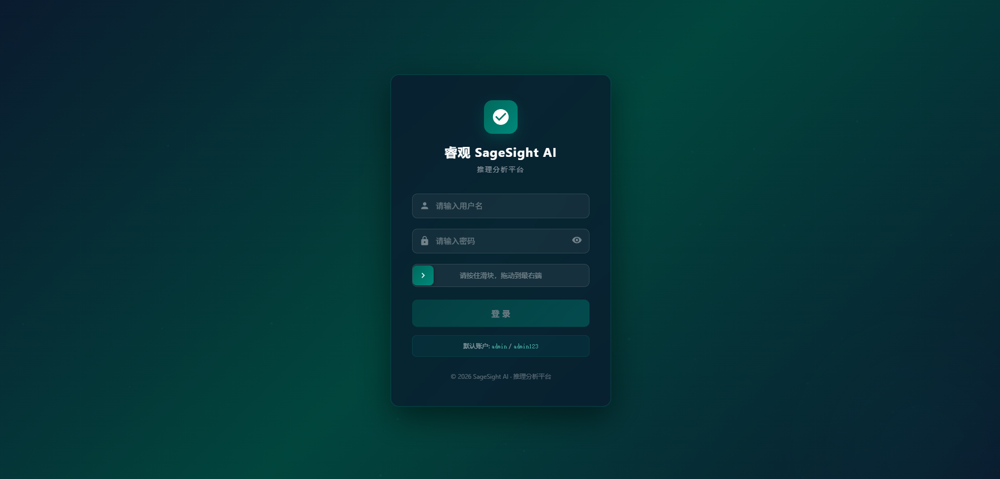
A clean, modern login interface supporting user authentication and secure login.

### Cockpit (Video Wall)
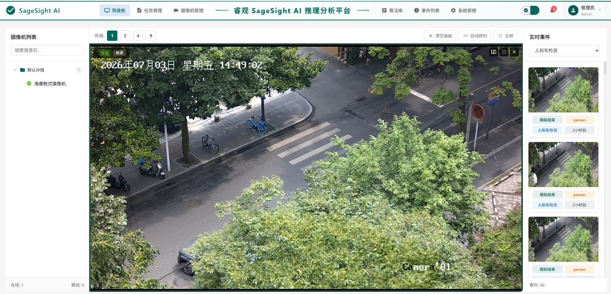
Multi-stream real-time monitoring with the latest event list on the right, supporting real-time viewing and analysis results.

### Task Management
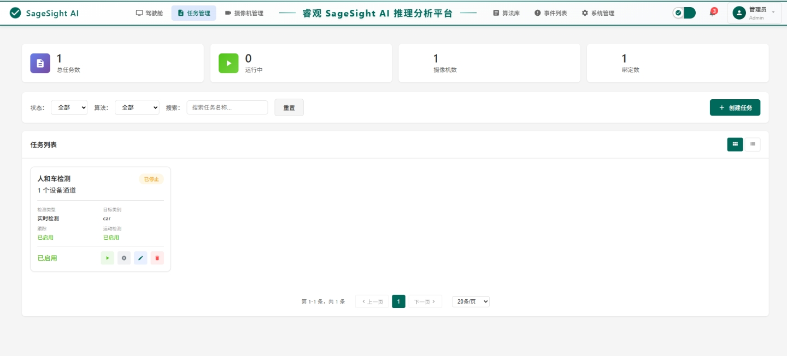
Flexible AI task management interface supporting task creation, editing, start/stop, and performance monitoring.

### Task Configuration
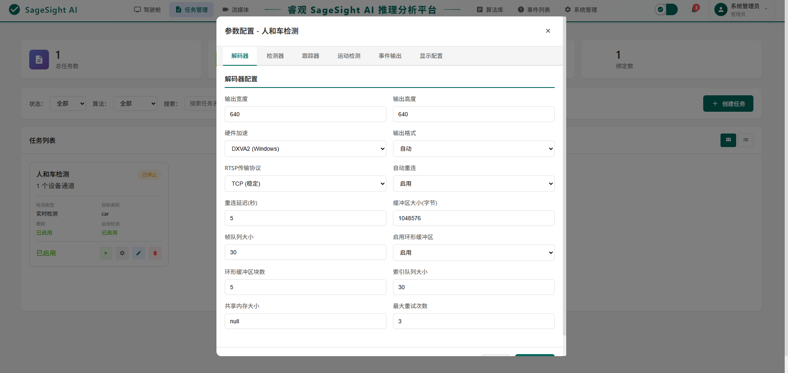
Detailed task configuration dialog supporting multi-module configuration of decoder, detector, tracker, event output, etc.

### Zone Configuration
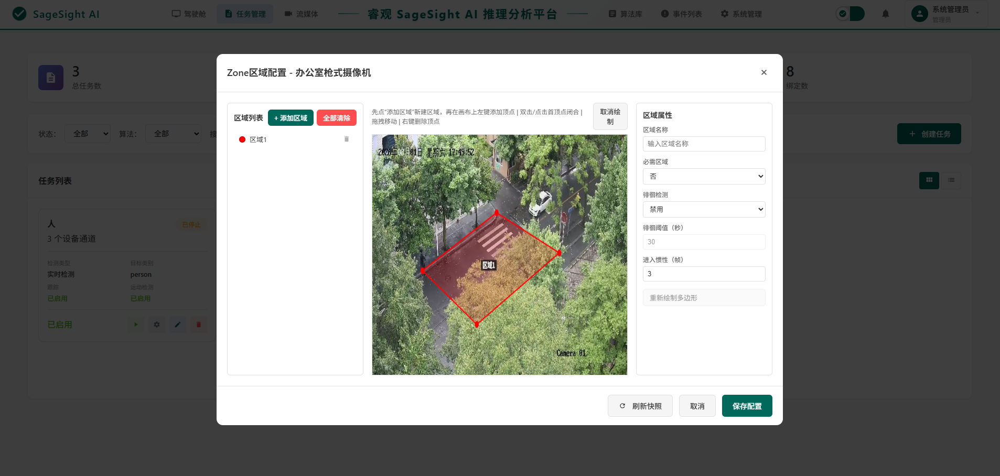
Zone detection configuration interface supporting drawing polygon detection zones on the frame, with required zones, loitering detection, object type whitelist, and other rules for precise zone monitoring.

### Event Management
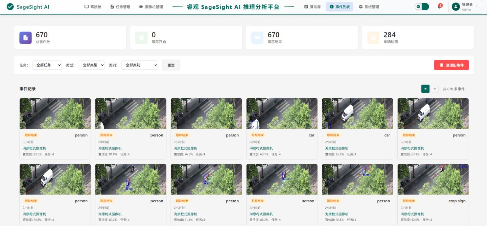
Event query and management interface supporting filtering by task, type, and class, viewing event details and GIF animations.

### Event Details
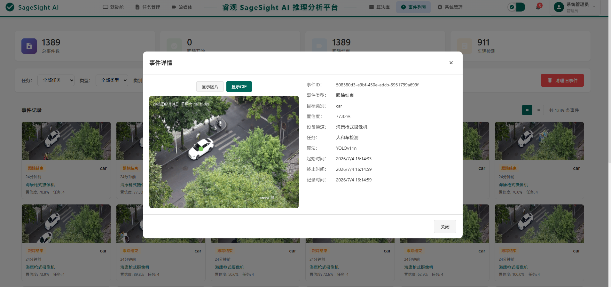
Event details dialog supporting switching between keyframe image and GIF animation for complete event information viewing.

### Playback Dialog
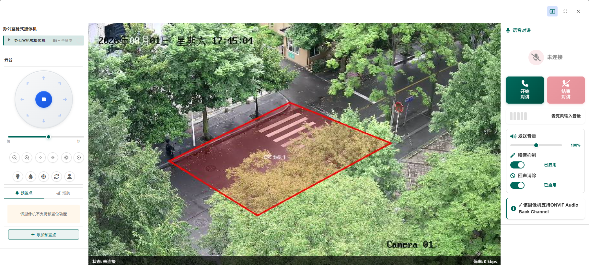
Video playback dialog supporting live stream playback and two-way voice intercom.

### Streaming Device Management
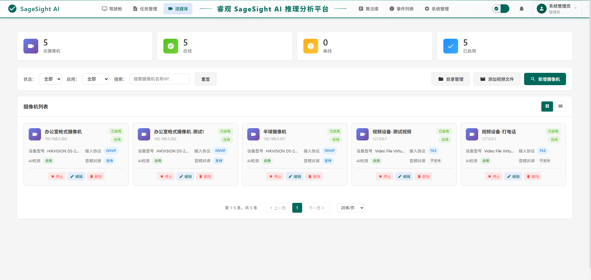
Camera management interface supporting ONVIF auto-discovery, PTZ control, and device channel pool management.

### Algorithm Library
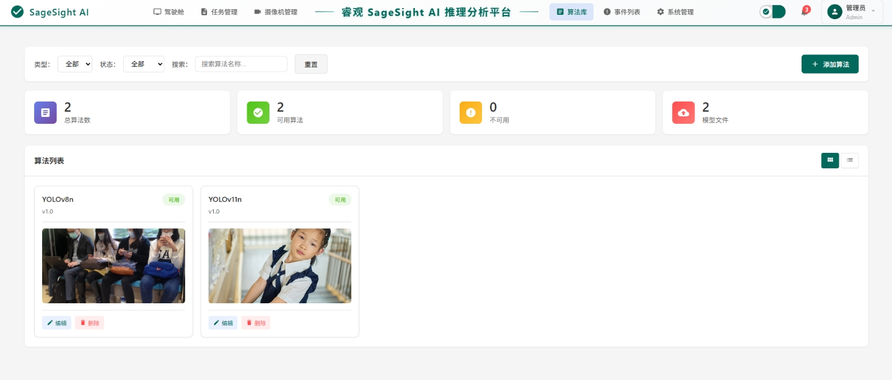
Algorithm configuration management interface supporting YOLOv8/YOLO11 and other algorithm configurations, model management, and class configuration.

### System Management
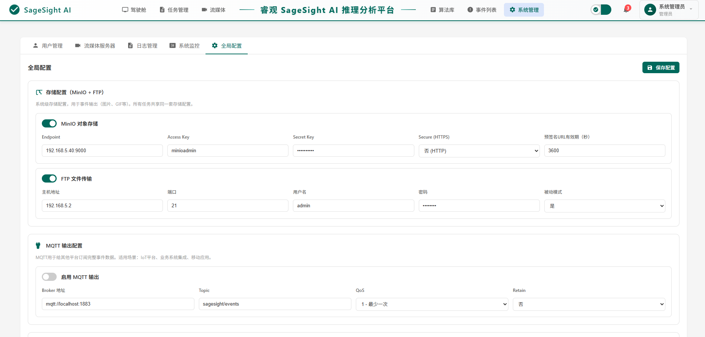
System configuration and monitoring interface supporting hardware monitoring, decoder configuration, and streaming media server configuration.

## Technical Features

### Multi-Platform Hardware Acceleration
- **NVIDIA GPU**: CUDA and TensorRT accelerated inference, RTX 2070 achieves 30+ FPS
- **CPU inference**: ONNX Runtime pure CPU inference, suitable for GPU-less environments
- **RK3588 NPU**: RKNN accelerated inference, suitable for embedded edge computing devices

### High-Performance Architecture
- **Zero-copy transmission**: Shared memory zero-copy frame transmission, reducing CPU overhead
- **Ring buffer**: Ring buffer + index queue architecture for efficient frame caching
- **Multi-process architecture**: Decoding, detection, tracking, and event processing in separate processes, fully utilizing multi-core CPUs
- **Global detection process pool**: Detector process pool centrally manages GPU resources, with multiple tasks sharing model instances

### Unified Log Management
- **Multi-process log collection**: Child processes send logs to the main process QueueListener via QueueHandler, written to files uniformly
- **Log rotation**: Automatic rotation by size, with backup count and console output configuration
- **Single source of truth**: Log level, format, file path, etc. uniformly read from `system_config.yaml`

## Quick Start

### 1. Environment Preparation

**Python Environment**:
- Python 3.11+
- pip package manager

**Hardware Environment (optional)**:
- NVIDIA GPU: CUDA 12.x + CuDNN 8.9+
- RK3588 platform: RKNN Toolkit2

### 2. Install Dependencies

**NVIDIA GPU platform**:
```bash
pip install -r requirements.txt
```

**CPU platform**:
```bash
# After installing dependencies, replace onnxruntime-gpu with onnxruntime in requirements.txt
pip install -r requirements.txt
```

**RK3588 platform**:
```bash
pip install -r requirements.txt
# Requires manual installation of rknn-toolkit2 (Rockchip official SDK)
```

### 3. Configuration Files

**Core configuration files** (`config/` directory):
- `system_config.yaml`: System configuration (web service port, hardware acceleration, storage configuration)
- `detector_config.yaml`: Detector configuration (inference backend, thresholds)
- `decoder_config.yaml`: Decoder configuration (hardware acceleration)
- `event_output.yaml`: Event output configuration (GIF, storage methods)
- `tracker_config.yaml`: Tracker configuration (Norfair parameters)
- `motion_config.yaml`: Motion detection configuration

**Inference backend selection**:
- `onnx_cuda`: CUDA accelerated inference (recommended for NVIDIA GPU)
- `onnx_cpu`: Pure CPU inference (GPU-less environments)
- `onnx_tensorrt`: TensorRT EP acceleration (high performance)
- `tensorrt`: Direct TensorRT Engine loading
- `rknn`: RKNN NPU inference (RK3588 platform)

### 4. Start the Service

**Start the web service**:
```bash
python run.py
```

**Access the platform**:
- Open a browser and visit: `http://localhost:5556`
- Default username: `admin`
- Default password: `admin123`

### 5. Quick Configuration

**Step 1: Configure cameras**
- Go to the "Streaming" page
- Click "ONVIF Discovery" to auto-search network cameras
- Or manually add RTSP stream addresses

**Step 2: Configure algorithms**
- Go to the "Algorithm Management" page
- Click "Add Algorithm Configuration"
- Select YOLOv8/YOLO11 model
- Configure detection classes and thresholds

**Step 3: Create a task**
- Go to the "Task Management" page
- Click "Add Task"
- Select camera channels and algorithm configuration
- Configure event output methods (local/MinIO/FTP)
- Start the task

**Step 4: View analysis results**
- Go to the "Video Wall" page
- View multi-stream monitoring frames in real-time
- Latest event list displayed on the right
- Click events to view details and GIF animations

### 6. Deployment Notes

**Recommended: Use phpStudy to manage database and FTP:**

phpStudy is an all-in-one server management tool integrating Apache/Nginx, MySQL/MariaDB, FTP, and other services, ideal for local development and deployment:

1. **Download**: [https://www.xp.cn/download.html](https://www.xp.cn/download.html)
2. **Installation and configuration**:
   - After installation, start MySQL service for database management
   - Start FTP service for remote storage of event images and GIFs
   - Default ports: MySQL 3306, FTP 21
3. **Configure connections**:
   - Configure FTP connection info in `config/system_config.yaml`
   - Configure MinIO connection info in `config/system_config.yaml` (optional)

**ZLMediaKit streaming media server configuration:**

This project uses ZLMediaKit as the streaming media server, supporting RTSP/RTMP/HTTP-FLV/HLS/WebRTC and other protocols. For configuration reference: [docs/流媒体服务器参数配置.MD](docs/流媒体服务器参数配置.MD)

**Key configuration notes**:
- **API configuration**: `api.secret` sets the API key
- **HTTP service**: Default port 88, supports cross-origin access
- **RTSP service**: Default port 554, supports direct proxy
- **RTMP service**: Default port 1935
- **RTC service**: Default port 8000, supports WebRTC voice intercom
- **Hook configuration**: Configure callback addresses for streaming media event notifications

**Configuration file path**: Save the configuration file as `config.ini` in the ZLMediaKit directory and start the service.

**Start command** (Windows):
```bash
MediaServer.exe
```

**Start command** (Linux):
```bash
./MediaServer
```

### Voice Intercom Usage Note (Non-localhost Access)

Voice intercom uses the browser `getUserMedia` API (microphone access), which requires a **Secure Context**. Browser rules:

- ✅ `https://` any address → secure
- ✅ `http://localhost` → special browser exemption (treated as secure)
- ❌ `http://192.168.x.x` → insecure, browser rejects `getUserMedia`

Therefore `http://localhost:5556` works, but `http://<network-IP>:5556` does not — this is a **browser security policy**, not a backend code restriction.

**Solution**: Make the browser treat your HTTP address as a "secure origin":

1. Open `chrome://flags/#unsafely-treat-insecure-origin-as-secure` in the browser address bar
2. Enter the platform address, e.g. `http://192.168.5.15:5556` (your platform IP address)
3. Select **Enabled** from the dropdown → click **Relaunch** to restart the browser
4. Revisit `http://192.168.5.15:5556` → `isSecureContext` becomes `true` → microphone available

## Application Scenarios

### Security Surveillance
- Intrusion detection: Automatically detect intruders and generate event GIFs
- Abnormal behavior: Detect abnormal behaviors and alarm in real-time
- Zone monitoring: Custom monitoring zones for precise detection

### Intelligent Transportation
- Vehicle detection: Real-time vehicle detection and traffic flow statistics
- Violation detection: Detect illegal parking, wrong-way driving, and other behaviors
- People flow statistics: Count people movement and analyze crowd density

### Industrial Inspection
- Safety monitoring: Detect whether personnel are wearing safety equipment
- Equipment monitoring: Detect equipment operating status
- Quality inspection: Detect product defects and quality issues

## Project Architecture

```
sagesight-AI/
├── config/              # Configuration files
│   ├── system_config.yaml    # System config (web service, hardware acceleration, storage, communication)
│   ├── detector_config.yaml  # Detector config (inference backend, thresholds)
│   ├── decoder_config.yaml   # Decoder config (hardware acceleration)
│   ├── event_output.yaml     # Event output config (GIF, storage methods, push)
│   ├── tracker_config.yaml   # Tracker config (Norfair parameters)
│   ├── motion_config.yaml    # Motion detection config
│   ├── zones_config.yaml     # Zone detection config
│   └── display_config.yaml   # Display config
├── src/                 # Source code
│   ├── decoders/        # Video decoders
│   │   ├── __init__.py
│   │   └── video_decoder.py
│   ├── detection/       # Zone detection
│   │   ├── __init__.py
│   │   └── zone_manager.py     # Zone manager
│   ├── pipeline/        # Detection pipeline
│   │   ├── __init__.py
│   │   └── camera_pipeline.py
│   ├── detectors/       # Object detectors
│   │   ├── __init__.py
│   │   ├── base.py             # Detector base class
│   │   ├── factory.py          # Detector factory
│   │   ├── detector_pool.py    # Detector process pool management
│   │   ├── detector_process.py # Detector process
│   │   ├── remote_detector.py  # Remote detector proxy
│   │   ├── region_utils.py     # Region detection utilities
│   │   └── backends/           # Inference backends
│   │       ├── onnx_cpu.py     # ONNX CPU backend
│   │       ├── onnx_cuda.py    # ONNX CUDA backend
│   │       ├── onnx_tensorrt.py # ONNX TensorRT backend
│   │       ├── tensorrt.py     # TensorRT direct loading
│   │       └── rknn.py         # RKNN NPU backend
│   ├── tracking/        # Object trackers
│   │   ├── __init__.py
│   │   ├── norfair_tracker.py  # Norfair tracker
│   │   ├── tracked_object.py   # Tracked object
│   │   └── ptz_metrics.py      # PTZ metrics
│   ├── events/          # Event output processing
│   │   ├── __init__.py
│   │   ├── event_output.py          # Event output (async I/O)
│   │   ├── tracked_object_processor.py # Tracked object processor
│   │   ├── event_cleanup_service.py # Event cleanup service
│   │   ├── gif_generator.py         # GIF generator
│   │   ├── minio_outputter.py       # MinIO storage
│   │   ├── ftp_outputter.py         # FTP storage
│   │   └── mqtt_outputter.py        # MQTT push
│   ├── tasks/           # Task management
│   │   ├── __init__.py
│   │   ├── task_manager.py               # Task data model
│   │   ├── task_executor.py              # Task executor (multi-camera)
│   │   ├── task_api.py                   # Task API
│   │   ├── device_channel_pool_manager.py # Device channel pool management
│   │   └── device_channel_pool_api.py    # Device channel pool API
│   ├── cameras/         # Camera management
│   │   ├── __init__.py
│   │   ├── camera_manager.py        # Camera manager
│   │   ├── camera_api.py            # Camera API
│   │   ├── stream_service.py        # Streaming media service
│   │   ├── stream_api.py            # Streaming media API
│   │   ├── ptz_service.py           # PTZ service
│   │   ├── ptz_api.py               # PTZ API
│   │   ├── directory_service.py     # Directory service
│   │   ├── directory_api.py         # Directory API
│   │   ├── audio_talk_service_onvif.py # ONVIF voice intercom
│   │   ├── audio_talk_api.py        # Voice intercom API
│   │   ├── onvif_client.py          # ONVIF client
│   │   └── onvif_audio_backchannel.py # ONVIF audio backchannel
│   ├── algorithms/      # Algorithm management
│   │   ├── __init__.py
│   │   ├── algorithm_manager.py  # Algorithm manager
│   │   ├── algorithm_api.py      # Algorithm API
│   │   ├── algorithm_factory.py  # Algorithm factory
│   │   └── model_manager.py      # Model management
│   ├── system/          # System management
│   │   ├── __init__.py
│   │   ├── system_manager.py     # System manager (streaming media config)
│   │   ├── system_api.py         # System API
│   │   └── system_config_loader.py # Config loader
│   ├── auth/            # User authentication
│   │   ├── __init__.py
│   │   ├── auth_manager.py  # Auth manager
│   │   └── auth_api.py      # Auth API
│   ├── motion/          # Motion detection
│   │   ├── __init__.py
│   │   └── improved_motion.py  # Improved motion detector
│   └── utils/           # Utilities
│       ├── __init__.py
│       ├── log_manager.py         # Unified log manager
│       ├── process.py             # Process management (BaseProcess/Process)
│       ├── shared_memory.py       # Shared memory
│       ├── frame_index_queue.py   # Frame index queue
│       ├── image.py               # YUV image processing
│       ├── cuda_processor.py      # CUDA processor
│       ├── rga_processor.py       # RGA processor (RK3588)
│       ├── rknn_executor.py       # RKNN executor
│       ├── ffmpeg_presets.py      # FFmpeg presets
│       ├── font_utils.py          # Font utilities
│       ├── platform_utils.py      # Platform utilities
│       └── video_utils.py         # Video utilities
├── static/              # Static assets
│   ├── css/             # Stylesheets
│   ├── js/              # JavaScript files
│   │   ├── jessibuca/    # Video player
│   │   └── h265web/      # H265 decoder
│   └── images/          # Image assets
│       └── algorithms/  # Algorithm sample images
├── templates/           # HTML templates
│   ├── base.html        # Base layout template
│   ├── login.html       # Login page
│   ├── monitor.html     # Video wall page
│   ├── tasks.html       # Task management page
│   ├── cameras.html     # Camera management page
│   ├── events.html      # Event management page
│   ├── algorithms.html  # Algorithm library page
│   └── system.html      # System management page
├── models/              # Model files
│   ├── detection/       # Detection models
│   └── labels/          # Label files
├── data/                # Data files
│   └── tasks.db         # SQLite database
├── docs/                # Documentation
│   └── images/          # Feature screenshots
├── logs/                # Log files
├── output/              # Output files (images, GIFs)
├── requirements.txt     # Python dependencies
└── run.py               # Entry script
```

## Changelog

### v2.0.0 (current version)
- ✅ Full multi-platform inference support (NVIDIA GPU, CPU, RK3588 NPU)
- ✅ Refined event GIF generation and three-channel storage (local, MinIO, FTP)
- ✅ Video wall and event management support image/GIF toggle display
- ✅ ONVIF Audio Back Channel two-way voice intercom (cross-brand compatible)
- ✅ ONVIF protocol auto-discovery and PTZ control
- ✅ Multi-stream real-time analysis and multi-object tracking (Norfair)
- ✅ Real-time event push (Socket.IO + native WebSocket + MQTT)
- ✅ Event output async I/O optimization (thread pool for storage/push, non-blocking detection pipeline)
- ✅ Automatic event cleanup (periodically clean up expired events and storage files by retention days)
- ✅ Unified log management (multi-process QueueHandler + QueueListener architecture)

## Technical Support

**Project URL**: https://gitee.com/hanx125/sagesight-ai

**Tech Stack**:
- Backend: Python + Flask + SocketIO + Eventlet
- Frontend: HTML + CSS + JavaScript
- Inference: ONNX Runtime + TensorRT + RKNN
- Decoding: FFmpeg + hardware acceleration
- Storage: SQLite + MinIO + FTP
- Communication: Socket.IO + native WebSocket + MQTT
- Voice intercom: ONVIF Audio Back Channel

## License

This project is for learning and research purposes only. It may be used commercially without authorization, but software patents and copyrights may not be applied for.

---

**SageSight AI** - Intelligent video analysis, making surveillance smarter

---

## Contact the Author
### Email

624662795@qq.com

### Add WeChat

If you have technical questions or collaboration needs, feel free to add the author's WeChat:


### Donation

If you find this project helpful, donations to support the author's continued development are welcome:

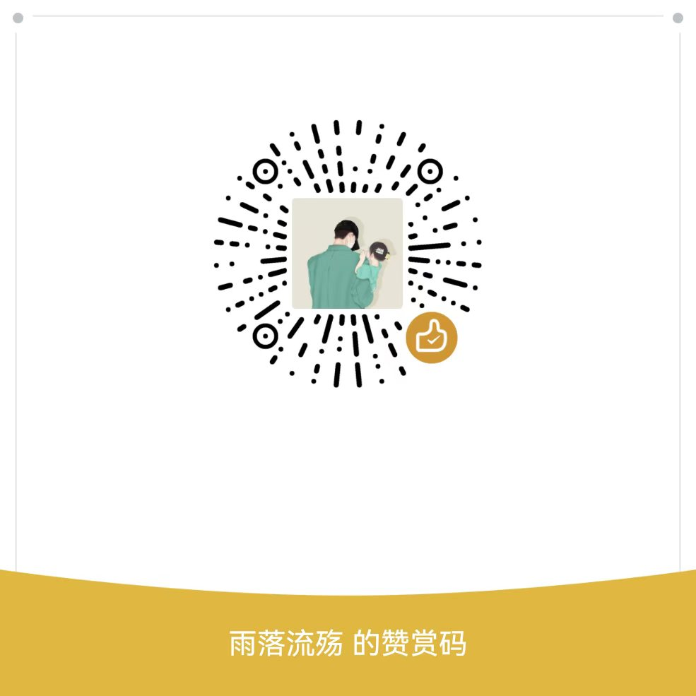
